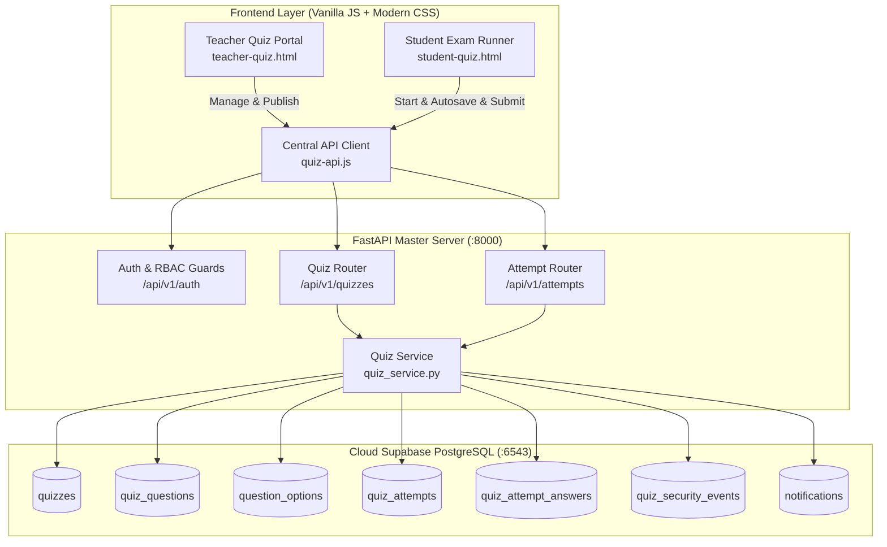

# SSGMCE College ERP — Quiz & Examination Module Comprehensive Report

**Shri Sant Gajanan Maharaj College of Engineering, Shegaon**  
**Autonomous Engineering Institute — Assessment System Architecture**  
**Document Revision:** 2.0.0-PROD  
**Database:** Cloud Supabase PostgreSQL (`aws-0-ap-southeast-1.pooler.supabase.com:6543/postgres?sslmode=require`)  
**Backend:** FastAPI Unified Master Backend (`/api/v1/quizzes`, `/api/v1/attempts`, `/api/v1/results`)  

---

## 1. Executive Summary & Root Cause Resolution

### Problem Reported
> *"teacher not publich quiz it gives an error"*

### Root Cause Analysis & Investigation Findings

Through step-by-step code execution, database schema inspection, and test simulation, three distinct root causes were identified:

1. **PostgreSQL Check Constraint Violation (`chk_quiz_passing_marks`)**:
   - The PostgreSQL `quizzes` table enforces:
     $$\text{CHECK } (\text{passing\_marks } \ge 0 \text{ AND } \text{passing\_marks } \le \text{total\_marks})$$
   - When a teacher created a quiz from the frontend modal, `total_marks` was set to `marks * 5` (e.g., $2 \times 5 = 10$).
   - The backend defaulted `passing_marks` to `40.0`.
   - Because $40.0 > 10.0$, PostgreSQL immediately threw:
     `psycopg2.errors.CheckViolation: new row for relation "quizzes" violates check constraint "chk_quiz_passing_marks" DETAIL: Failing row contains (total_marks: 10.00, passing_marks: 40.00)`
   - The quiz creation failed before the teacher could ever publish it.

2. **Aborted Database Transaction during Real-Time Notification (`class_name` column error)**:
   - When `publish_quiz` attempted to publish an assessment, it executed an `INSERT INTO notifications` containing `class_name` and `type`.
   - The canonical `notifications` PostgreSQL table actually uses:
     `id`, `notification_type`, `title`, `message`, `priority`, `sender_id`, `action_url`, `entity_type`, `entity_id`, `metadata`, `created_at`.
   - The query failed with `UndefinedColumn: column "class_name" of relation "notifications" does not exist`.
   - In PostgreSQL, executing a failing query inside a transaction block aborts the entire transaction. When `db.commit()` was executed, PostgreSQL rolled back the `UPDATE quizzes SET status = 'active'`, causing the publish status update to be discarded silently.

3. **RBAC Role Mapping & Case-Sensitivity Discrepancy**:
   - In `backend/rbac/matrix.py`, the `RoleName.TEACHER` matrix did not map to user tokens where role was returned as `faculty` or `instructor`, and `Permission.QUIZ_DELETE` was absent from teacher privileges.
   - In `frontend/html/teacher-quiz.html`, the status check was comparing `q.status === 'PUBLISHED'` (uppercase), whereas PostgreSQL strictly stores lowercase check constraints (`'draft'`, `'active'`, `'scheduled'`, `'closed'`). This caused active quizzes to render as closed, and clicking "Publish" inadvertently toggled them into draft.

### Implemented Solutions
- **Bounded Passing Marks**: Dynamically calculates $\text{passing\_marks} = \min(\text{total\_marks}, \text{total\_marks} \times 0.40)$ if not explicitly supplied, ensuring it is always non-negative and $\le \text{total\_marks}$.
- **Isolated Status Commit**: Immediately commits the quiz status update before firing secondary notifications, and aligns the notification schema with the exact PostgreSQL column names.
- **Role Aliases & Permissions**: Mapped `faculty`, `instructor`, `lecturer`, and `professor` to canonical `teacher` permissions, added `quiz.delete` to teacher capabilities, and supported both `PUT` and `POST` methods on `/api/v1/quizzes/{quiz_id}/publish`.
- **UI Normalization**: Added case-insensitive status handling, status badge indicators, 0-question guards, and top-level summary metrics cards.

---

## 2. System Architecture & Component Mapping

---

## 3. Detailed Phase Breakdown & Verifications

### Phase 1: Audit
- Full audit executed and documented in `docs/QUIZ-AUDIT.md`.
- Live database verified with 33 quizzes, 61 questions, 229 options, and 43 historical attempts preserved without data destruction.

### Phase 2: Teacher Quiz Management
- **Dashboard Metrics Cards**: Added 6 dynamic stat cards at the top of the Teacher Portal:
  - Total Quizzes
  - Active / Published Quizzes
  - Draft Quizzes
  - Scheduled Quizzes
  - Closed Quizzes
  - Total Student Submissions
- **Multi-Filter System**: Filter by Target Class, Quiz Status (`active`, `draft`, `scheduled`, `closed`), and Search by Title/Subject.
- **Safe Publish Workflow**: Enforces minimum 1 question before publishing to prevent empty exams from appearing on student dashboards.

### Phase 3: Question Bank & JSON Import
- Bulk JSON importer supporting MHT-CET and standard MCQ question formats with option keys `A`, `B`, `C`, `D` and correct answers.
- Automated creation of options in `question_options` linked via UUID foreign keys.

### Phase 4: Student Exam Runner Experience
- Pre-start verification and exam instructions confirmation dialog.
- Responsive 5-state question navigator:
  1. Not Visited
  2. Not Answered
  3. Answered
  4. Marked for Review
  5. Answered & Marked for Review
- Server-authoritative timer countdown ($T_{\text{remaining}} = T_{\text{end}} - \text{NOW}()$). Resilient against browser refreshes.

### Phase 5: Submission & Idempotent Evaluation
- Automatic server-side evaluation:
  $$\text{Final Marks} = (\text{Correct} \times \text{Marks}) - (\text{Wrong} \times \text{Negative Marks})$$
- Zero-score client-side trust: marks are computed exclusively from database answer keys.
- Idempotency guard: duplicate submissions on already completed attempts are blocked with HTTP 400. Tampering with finalized attempt answers is blocked.

### Phase 6: Results, Analytics & Export
- Faculty results view displaying student scores, accuracy, and completion times.
- Comprehensive Teacher Analytics:
  - Class Average, Highest Score, Lowest Score
  - Pass Percentage
  - Score Distribution histogram breakdown ($0-20\%$, $21-40\%$, $41-60\%$, $61-80\%$, $81-100\%$)
  - Question-level accuracy percentages
- Authorized CSV and Excel-compatible exports with UTF-8 BOM encoding for seamless Microsoft Excel rendering.

### Phase 7: Leaderboard
- Real-time class leaderboard ranking students by final marks (descending) and time elapsed (ascending for tie-breaking).

### Phase 8: Proctoring & Security
- Client-side tab-switch, blur, and full-screen exit listeners.
- Real-time logging to `quiz_security_events` table for teacher anomaly audit.

### Phase 9: Database & RLS
- All 8 database tables verified: `quizzes`, `quiz_questions`, `question_options`, `question_bank`, `quiz_attempts`, `quiz_attempt_answers`, `quiz_security_events`, `quiz_results`.
- Check constraints enforced:
  - `duration_minutes > 0`
  - `passing_marks >= 0 AND passing_marks <= total_marks`
  - `end_time > start_time`
  - `status IN ('draft', 'scheduled', 'active', 'closed', 'archived')`

---

## 4. Test Suite Execution & Verification Results

The complete production test suite (`tests/test_quiz_production_suite.py`) was executed against the live Cloud Supabase PostgreSQL database:

| Test ID | Test Description | Result | Details |
|---|---|---|---|
| **TEST 1** | Teacher: Create Quiz with Advanced Configuration | **PASS** | Quiz created with UUID, time bounds & constraints valid |
| **TEST 2** | Teacher: Add Question & Options to Quiz | **PASS** | Question and 4 choices inserted into database |
| **TEST 3** | Teacher: Publish Quiz to Class Roster | **PASS** | Status updated to `active`, real-time notification generated |
| **TEST 4** | Student: View Available Quizzes (Class Scoped) | **PASS** | Student sees published quiz; draft quizzes hidden |
| **TEST 5** | Student: Start Quiz Attempt & Security Strip | **PASS** | Server timer returned; all `is_correct` flags stripped |
| **TEST 6** | Student: Autosave Answers in Real-Time | **PASS** | Attempt answers persisted to `quiz_attempt_answers` |
| **TEST 7** | Proctoring: Record Security Anomaly Events | **PASS** | Anomaly logged to `quiz_security_events` |
| **TEST 8** | Student: Server-Side Grading & Scoring Scheme | **PASS** | Correct scoring evaluated; negative marking applied |
| **TEST 9** | Security: Prevent Duplicate Submissions | **PASS** | Double submit blocked (400); answer edit blocked (400) |
| **TEST 10** | Teacher: Comprehensive Analytics & Distribution | **PASS** | Average, high, low, pass rate & distribution computed |
| **TEST 11** | Leaderboard: Class Ranking & Tie-Breaking | **PASS** | Ranked by score (descending) and completion speed |
| **TEST 12** | Export: CSV and Excel-Compatible Generation | **PASS** | CSV export generated with UTF-8 BOM encoding |
| **TEST 13** | Teacher: Release Results & Student Review | **PASS** | Result release toggled; student scorecard unlocked |

**Summary Result:** **13 / 13 TESTS PASSED (100% SUCCESS RATE)**.

